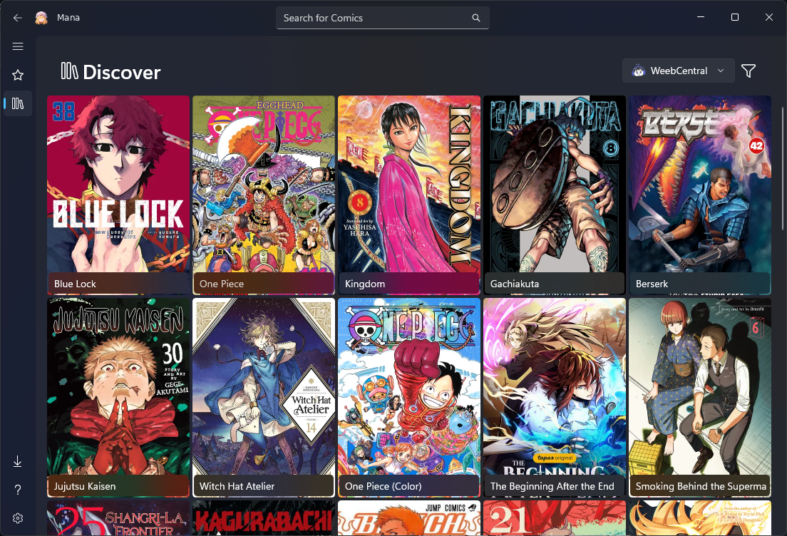

<div align="center">
  <h1>
     Mana
  </h1>
</div>

<div align="center">
  
  
  
  
</div>

<div align="center">
    <h2>📖 Overview</h2>

**Mana** is a modern, extensible manga, webtoon, and comic reader for **Windows**. Current project version: **1.7.0**.

Built with **WinUI 3** and **.NET 10**, it provides a Fluent Design interface, a local **SQLite**-backed library, and plugin-based source support. Your library and reading data stay on your device; Mana has no telemetry, ads, or required account.

🌐 **Project website:** [compromisee.github.io/Mana](https://compromisee.github.io/Mana/) · [Source and releases](https://github.com/compromisee/Mana). The Pages workflow publishes `docs/` on pushes to `main` or `master`; set **Settings → Pages → Build and deployment → GitHub Actions** once in the repository.

Read your local and downloaded collection offline, or enable online discovery through community sources.



[More screenshots](/Yukari/Assets/Screenshots/)

</div>

<div align="center">
    <h2>✨ Features</h2>
</div>

- 📚 **Organized library** — Favorites collections with colors and names; local titles can be grouped, renamed, and color-coded
- 📥 **Download queue** — Per-chapter progress and page counts, queue position, and estimated time remaining
- 📂 **Local comics** — Read image folders, CBZ, and EPUB files; select multiple titles in grid view to assign a group
- 🔍 **Online discovery** — Search enabled sources and jump from a local title to an online search
- 🏷️ **Tags** — View comic tags and use source genre filters
- 🧩 **Aidoku sources** — Import and run `.aix` sources, with their filters and tags
- 📖 **Reader** — RTL, LTR, vertical, and webtoon modes; multiple scaling modes, zoom, and page navigation
- 🌙 **Dark and light themes** — Follows the Windows system theme or your selected preference
- 🛡️ **Private by default** — No telemetry, ads, mandatory login, or cloud sync
- 🌍 **Multilingual interface** — English, Portuguese, Spanish, and Japanese

<div align="center">
    <h2>📥 Installation</h2>
</div>

1. Open [Mana Releases](https://github.com/compromisee/Mana/releases).
2. Download the latest `Mana.Setup.<architecture>.exe` installer or the minimal ZIP for your Windows architecture.
3. Run the installer, or extract the ZIP and launch `Mana.exe`.

<div align="center">
    <h2>📚 Adding sources</h2>

Mana does not ship with pre-installed comic sources. Add only sources you trust, in accordance with the laws and terms that apply to you.
</div>

- For supported community plugins, browse the [original Yukari-App repositories](https://github.com/orgs/Yukari-App/repositories?q=Plugin+sort%3Aname-asc) and check each plugin's compatibility before installation.
- Aidoku `.aix` packages can be managed in Mana's **Sources** section. Source repositories are not enabled by default; review a repository before enabling it.
- After adding a source, open **Discover** to search and explore its available titles.

<div align="center">
    <h2>🗒️ Building from source</h2>
</div>

Mana uses **WinUI 3 / Windows App SDK** and must be built on Windows with the .NET 10 SDK. See [packaging.md](packaging.md) for build, publish, and installer instructions. The current project and solution paths retain their upstream `Yukari` filenames. Mana also preserves the existing `%APPDATA%/Yukari` data directory so upgrades can keep the original library and settings.

```powershell
dotnet run --project .\Yukari\Yukari.csproj -c Debug -p:Platform=x64
```

<div align="center">
    <h2>⚠️ Disclaimer</h2>
</div>

Mana is a reading application. It does not host, provide, aggregate, or distribute comic content. Online content is accessed through user-selected third-party sources and plugins. Mana is not affiliated with or responsible for those sources or the material they provide. Users are responsible for complying with applicable law and source terms.

<div align="center">
    <h2>🤝 Contributing</h2>
</div>

Contributions, bug reports, and feature suggestions are welcome. Please open an issue or pull request in the [Mana repository](https://github.com/compromisee/Mana).

<div align="center">
  <h2>📜 License and upstream credit</h2>
</div>

Mana is a fork/continuation of **[Yukari](https://github.com/Yukari-App/Yukari)**. It builds on the original Yukari project, its architecture, code, and community work. Credit and thanks go to **TXG0Fk3**, the original Yukari author, and the Yukari-App maintainers and contributors. The app's existing `Yukari` project and source paths are retained for compatibility and to make the lineage clear.

Mana is distributed under the **GNU General Public License v3.0 (GPL-3.0)**. See [LICENSE.txt](LICENSE.txt) for the license terms. The Yukari upstream project and its contributors are independent of this Mana fork; please consult the upstream repository for its history and contributor list.
